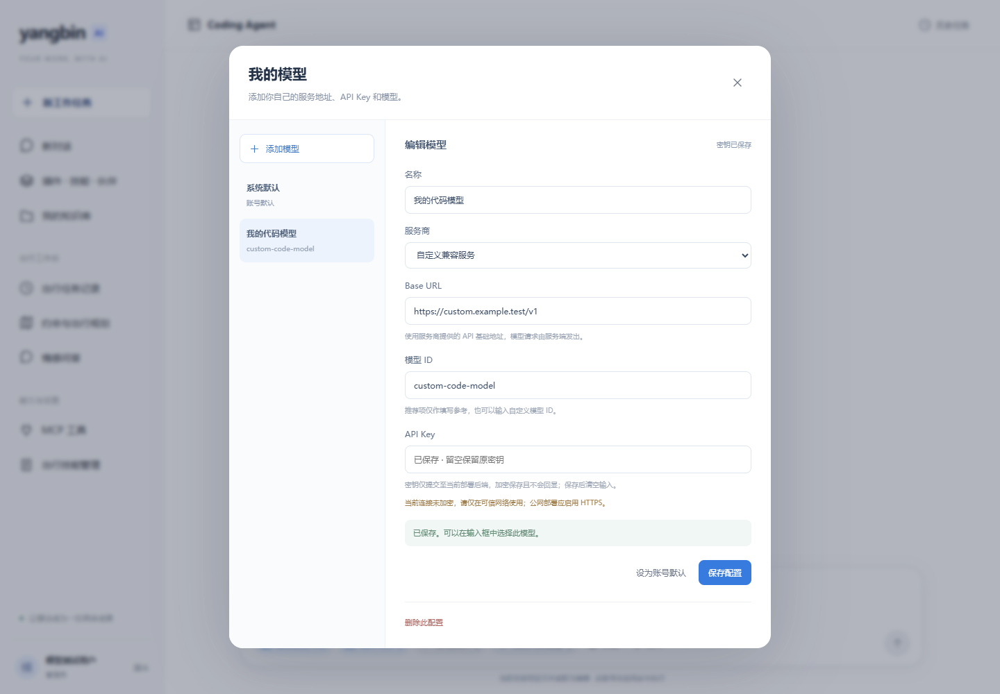
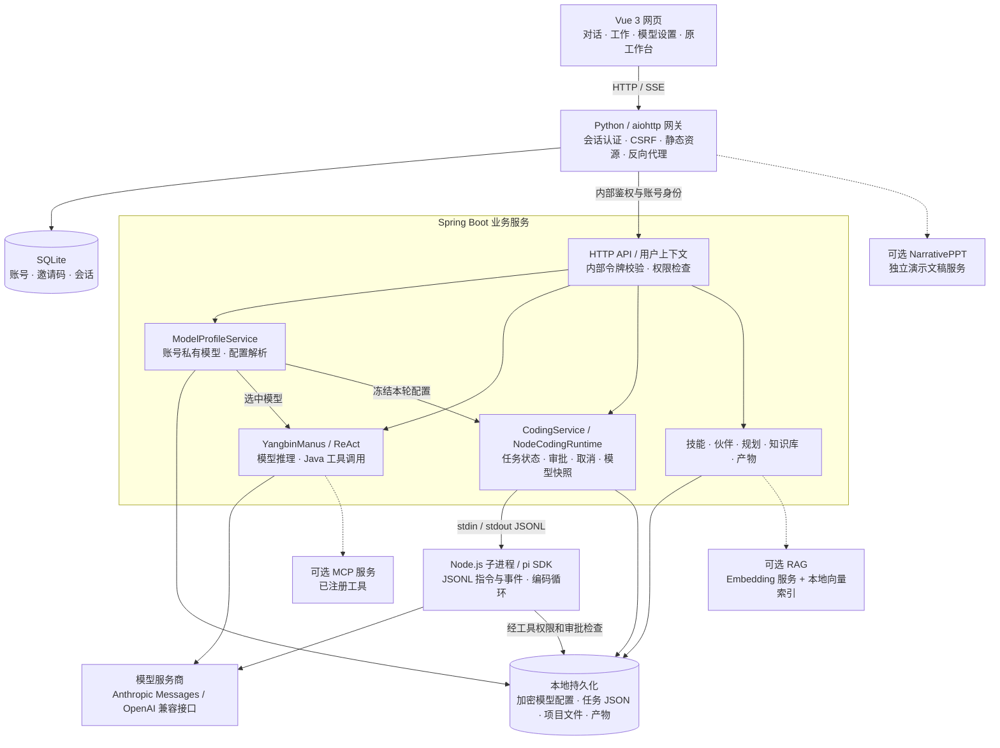

# yangbin AI Agent

**一个网页，两种工作方式：AI 超级智能体对话与基于 pi 的 Coding Agent。**

Bring your own model, keep projects private, and review tool actions before they run.

[](https://github.com/BStronger1/yangbin-ai-agent/actions/workflows/build.yml)

[架构](#项目架构) · [功能模块](#功能模块) · [技术选型](#技术选型) · [快速开始](#本地运行) · [模型接入](docs/MODEL-PROVIDERS.md) · [部署](docs/SELF-HOSTING.md) · [贡献](CONTRIBUTING.md) · [来源与许可](NOTICE.md)

## 能做什么

- **对话**：选择自己的模型，使用现有 ReAct 超级智能体与工具链。
- **工作**：创建服务端私有项目，让 pi Coding Agent 读取、编写、编辑文件；查看实际工具事件、审批、取消、历史任务和最近一轮文本差异。
- **自带模型**：Claude 原生 Messages、OpenAI / DeepSeek / Kimi 的兼容接口，以及自定义兼容 Base URL 和模型 ID。配置按账号隔离，API Key 在服务器加密保存、不回显。
- **可控执行**：始终询问 / 按需确认 / 全部允许；命令工具还需管理员在服务器单独开启。
- **原工作台**：技能、伙伴、知识库、出行规划与来源核查仍保留。NarrativePPT 是需要独立配置的可选服务。



*界面截图使用模拟账号与示例地址，不包含真实凭据。*

## 项目架构

项目采用 **Vue 网页 + Python 账号网关 + Spring Boot 业务服务 + Node.js Coding 运行时**。聊天和编码共用账号与个人模型配置，但走不同的执行链路。下图实线表示核心调用或数据访问，虚线表示需要额外启用或部署的扩展；这些层次不代表每个模块都是独立微服务。



### 两条核心执行链路

- **对话**：浏览器经网关提交消息和模型配置 ID → 后端按当前账号解析模型 → `YangbinManus` 执行 ReAct 推理与工具调用 → 通过 SSE 返回步骤、工具事件与回答。当前是单次任务，不是新增的跨会话长期记忆系统。
- **工作**：浏览器提交项目、提示词、`requestId`、版本号和模型配置 ID → `CodingService` 校验并保存轮次 → 独立 Node 子进程运行 pi → 需要确认的工具等待网页审批 → 实际执行文件操作并保存事件、状态及最近一轮差异。网页通过 HTTP 轮询恢复任务状态；Java 与 Node 之间使用 JSONL，不把它误写成浏览器 SSE。

个人模型配置提供统一的账号归属和选择语义；Java 对话通过 Spring AI 适配，Node 编码通过 pi 适配，二者分别处理对应供应商协议。RAG、MCP 和技能工作台的存在不意味着 Coding Agent 已自动接入这些扩展。

### 数据与权限边界

| 数据 | 当前存储方式 | 约束 |
| --- | --- | --- |
| 账号、邀请码、登录会话 | 网关 SQLite，默认 `tmp/auth/accounts.sqlite` | 密码使用 scrypt；会话 Cookie 与写操作 CSRF 校验 |
| 个人模型配置 | `tmp/model-profiles/` 下的账号文件 | API Key 使用 AES-256-GCM；只返回是否已保存，主密钥与密文须共同备份 |
| Coding 项目与轮次 | `tmp/coding/<owner>/` | 服务端私有目录；保存轮次、事件、模型快照和文件，不等于用户电脑的仓库 |
| 任务、伙伴、技能与产物 | `tmp/` 下对应模块目录 | JSON 检查点与文件存储，按业务入口校验账号归属；不是统一关系型业务数据库 |
| 知识库向量索引 | 启用 RAG 后的 `SimpleVectorStore` 与本地 JSON 索引 | 检索限制为公共资料和当前账号资料；Embedding 服务需另行配置 |

浏览器不持有内部服务鉴权令牌。网关注入已认证的账号身份，后端校验内部请求并在业务层执行权限检查；独立部署时应按[部署指南](docs/SELF-HOSTING.md)限制后端入口。工具审批是应用层控制，Node 子进程与目录约束不构成操作系统沙箱。

## 功能模块

以下按当前源码整理；“可选”表示已有接入代码，但需要额外配置，并非首次启动即全部可用。

| 模块 | 已实现功能 | 页面或源码入口 | 范围说明 |
| --- | --- | --- | --- |
| 双模式首页 | 对话 / 工作切换，模型选择，最近项目与任务入口 | `/work`；[CodingWorkspace.vue](yangbin-ai-agent-frontend/src/views/CodingWorkspace.vue) | 对话与工作分别记住非密钥模型选择 |
| AI 超级智能体 | ReAct 推理、Java 工具调用、执行事件与 SSE 回答 | `/work?mode=chat`；[agent](src/main/java/com/yangbin/yangbinaiagent/agent) | 单次 Manus 任务，工具依赖与权限分别配置 |
| Coding Agent | 私有项目、读写与精确编辑、三档审批、取消、历史恢复、文本差异 | `/work?mode=work`；[coding](src/main/java/com/yangbin/yangbinaiagent/coding)、[pi 运行时](coding-agent) | 命令执行另需管理员开启；未实现本机仓库或 Git/PR 操作 |
| BYOK 模型管理 | Claude / OpenAI / DeepSeek / Kimi / 自定义兼容配置，增删改与默认模型 | 输入栏“模型设置”；[models](src/main/java/com/yangbin/yangbinaiagent/models) | 本轮主要接入对话与 Coding，不表示所有旧工作台都已迁移到个人模型 |
| 账号与访问控制 | 邀请注册、登录、改密、管理员账号控制、会话与 CSRF | `/account`；[accounts.py](deploy/turing/accounts.py)、[proxy.py](deploy/turing/proxy.py) | 普通账号与管理员权限分开，资源按账号校验 |
| 技能与工作伙伴 | 技能目录、个人技能管理、伙伴任务与历史、附件及资源产物 | `/skills`、`/skills/manage`、`/partners/:partnerId`；[work](src/main/java/com/yangbin/yangbinaiagent/work) | 伙伴是当前业务工作区，不是并行多 Agent 调度器 |
| 任务与出行规划 | 有界步骤规划、确认、检查点、重试/取消、方案版本、来源检查与一次纠错 | `/tasks`、`/planner`；[tasks](src/main/java/com/yangbin/yangbinaiagent/tasks)、[planner](src/main/java/com/yangbin/yangbinaiagent/planner) | 围绕既有出行流程，来源规则不等于全文事实核验 |
| 知识库 / RAG（可选） | 文档上传、预览、索引、检索、删除与引用 | `/knowledge`；[rag](src/main/java/com/yangbin/yangbinaiagent/rag) | 默认关闭；需配置 Embedding 服务与模型文件 |
| MCP（可选） | 独立 MCP 服务接入、工具查看与测试 | `/mcp`；[MCP 服务](yangbin-image-search-mcp-server) | 仅开放已注册工具，不宣称任意插件自动接入 |
| 文件与演示产物 | 既有 PDF、Excel、PNG、演示文稿生成及预览下载入口 | `/presentation`；[work](src/main/java/com/yangbin/yangbinaiagent/work) | 内置产物能力与独立 NarrativePPT 接入分开；后者需单独部署 |

## 技术选型

版本依据仓库中的 [pom.xml](pom.xml)、[前端依赖](yangbin-ai-agent-frontend/package.json)和 [Coding 依赖](coding-agent/package.json)，表示当前实现基线，不表示推荐的最新版本。

| 层次 | 技术 | 在当前项目中的作用与取舍 |
| --- | --- | --- |
| Web 界面 | Vue 3.5.44、Vue Router、Vite 8.3.4 | 组件化组织双模式工作区与设置面板；Vite 构建静态资源，网关统一提供访问入口 |
| 请求与内容展示 | Axios、浏览器 SSE、Marked + DOMPurify | JSON API、对话事件与 Markdown 展示；Coding 状态使用轮询，Markdown 渲染后净化 |
| 业务后端 | Java 21、Spring Boot 3.4.4 | HTTP API、账号上下文、任务状态、文件访问与已有 Java 业务模块 |
| 对话模型与工具 | Spring AI 1.0.0、OpenAI / Anthropic 适配器 | 使用一致的模型/工具接口组织 ReAct；供应商协议差异仍需显式适配和测试 |
| 编码运行时 | Node.js ≥22.19、pi SDK 1.3.0、Undici | 复用 pi 的编码会话与模型循环，项目负责工作区、审批、进程桥接及安全约束；不是从零自研 pi |
| 账号入口 | Python ≥3.10、aiohttp、SQLite | 统一登录、静态资源、流式代理与账号数据；本地试用无需外部账号数据库 |
| 持久化与密钥 | 本地 JSON / JSONL / 文件、AES-256-GCM | 便于单实例检查点恢复与备份；不将文件存储宣称为分布式任务系统，主密钥须妥善保管 |
| 检索扩展 | Spring AI SimpleVectorStore、FastEmbed / 多语 MiniLM | 可选本地向量检索链路；默认 Embedding 脚本使用预备模型缓存，需单独安装相关依赖 |
| 文件产物 | Apache POI 5.5.1、iText 9.1.0、Java 图像处理 | 支撑已有 Office、PDF 与图片产物模块；不同模块有各自输入和格式限制 |
| 验证与交付 | Maven / JUnit、Node Test Runner、Python unittest、Playwright、GitHub Actions | 覆盖协议、账号隔离、审批、真实文件写入与浏览器交互；CI 使用本地模拟模型避免消耗 API 额度 |

**默认运行依赖与保留样例分开：** 最小试用不要求 PostgreSQL、PgVector、Redis、Ollama、Embedding 或 MCP 服务。仓库中保留了课程相关依赖和样例配置，不能仅凭 `pom.xml` 出现某个依赖，就认定它已进入当前默认运行链路。原生各厂商接口的可用性仍需用户自己的账号、额度和模型权限。

## 本地运行

需要 **Java 21+、Maven 3.9+、Node >=22.19、Python >=3.10**。首次构建需要下载依赖。

```bash
git clone https://github.com/BStronger1/yangbin-ai-agent.git
cd yangbin-ai-agent
python -m venv .venv
# Linux/macOS: source .venv/bin/activate
# Windows PowerShell: .venv\Scripts\Activate.ps1
python -m pip install -r deploy/turing/requirements.txt
python tools/run_local.py --build
```

首次启动会让你设置本地管理员密码（输入不显示）。打开 **http://127.0.0.1:18825/work**，默认账号为 `admin`。在输入栏的模型菜单进入“模型设置”，填写厂商、Base URL、模型 ID 和 API Key，然后分别在“对话”和“工作”中选择它。

无需先配置全站共享模型。已有构建后直接 `python tools/run_local.py`；用 `--check` 检查环境，用 Ctrl+C 停止本次服务。启动器仅监听本机，不覆盖已有账号密码。MCP、RAG、NarrativePPT 和命令执行默认不开启。

## 一个可验证的开始

切到“工作” → 新建项目 → 选择模型 → 输入：

> 创建一个 index.html，实现一个带增减按钮的计数器。先说明计划，在获得写入批准后创建文件。

检查审批中的路径与内容，再允许执行。在“项目文件”中查看实际文件和差异。模型说“完成”不替代运行测试；命令功能关闭时，页面不应将未执行的命令写成成功。

## 当前边界

当前文件位于服务器的账号私有项目中，**不是你浏览器所在电脑的仓库**。尚无本机连接器、Git/PR工作流、应用预览或产品内多Agent并行调度。对话模式沿用单次Manus任务；Coding任务支持历史恢复。

命令工具以服务账号执行，**不是操作系统沙箱**。请勿把开启命令的部署用于不可信多租户。文件工具支持有界UTF-8文本；最近一轮差异不等于完整Git diff。厂商/模型可用性和工具调用支持取决于你的账号及所选模型，协议模拟测试不等于每家付费模型实测。

## 源码导航

| 路径 | 职责 |
| --- | --- |
| `yangbin-ai-agent-frontend/` | Vue 3 界面、双模式输入栏与模型设置 |
| `src/main/java/` | Spring Boot 账号上下文、模型配置、任务和工具编排 |
| `coding-agent/` | 固定版本 pi SDK、JSONL进程接口与审批工具 |
| `deploy/turing/` | 会话/CSRF网关、账号库及专用部署脚本 |
| `tools/run_local.py` | 不依赖个人服务器目录的本地启动 |
| `src/main/java/com/yangbin/yangbinaiagent/models/` | 个人模型配置、加密、端点策略与 Java 模型适配 |
| `src/main/java/com/yangbin/yangbinaiagent/agent/` | ReAct 推理、工具调用与 SSE 输出 |
| `src/main/java/com/yangbin/yangbinaiagent/coding/` | Coding 项目、轮次、审批状态和 Node 进程桥接 |
| `src/main/java/com/yangbin/yangbinaiagent/work/` | 工作伙伴、技能任务和产物服务 |
| `yangbin-image-search-mcp-server/` | 可选独立 MCP 服务 |
| `tools/evaluation/`、`evaluation/` | 冻结输入、评测契约与报告工具 |
| `.github/workflows/build.yml` | 前后端、协议与浏览器持续集成 |

## 验证与贡献

CI使用本地模拟模型，避免消耗贡献者API额度。协议、隔离、审批和页面测试说明见 [CONTRIBUTING.md](CONTRIBUTING.md)。错误报告请说明操作步骤、预期/实际结果、浏览器与模型协议，**不要附API Key或私人会话**。

欢迎提交可复现问题、文档纠错、协议兼容性修复和可验证的小PR。新功能与能力边界见 [ROADMAP.md](ROADMAP.md)；不以测试数或单个案例宣称通用模型质量。

## 来源与许可

本项目是 [liyupi/yu-ai-agent](https://github.com/liyupi/yu-ai-agent) 的课程学习改造，个人扩展包括账号工作台、验证链路、pi适配和BYOK体验。pi SDK的版权许可保留在 [coding-agent/PI-LICENSE](coding-agent/PI-LICENSE)。原始快照未附整体许可证，当前不声称整个仓库获得MIT/Apache等开放授权；请先阅读 [NOTICE.md](NOTICE.md) 与 [LICENSING.md](LICENSING.md)。
